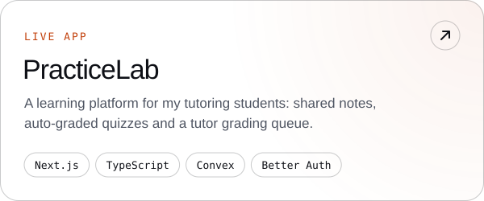
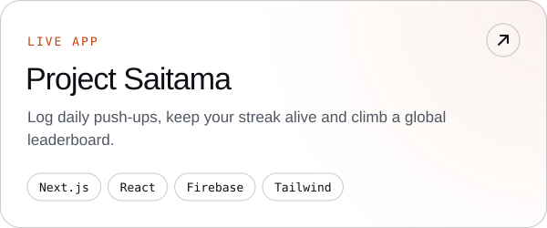
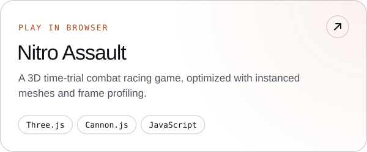
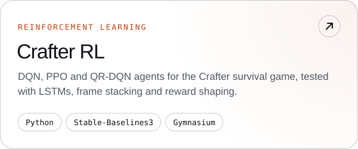
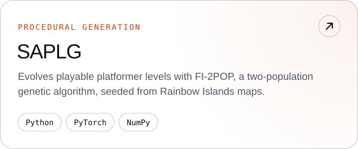
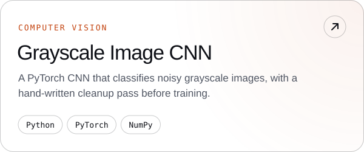

<picture>
  <source media="(prefers-color-scheme: dark)" srcset="assets/banner-dark.svg">
  
</picture>

  
  
  
  

I'm a full-stack software engineer at **Proking Solutions** in Johannesburg, South Africa. I take client products from requirements to production in TypeScript, Next.js and Node.js, use Python for data and AI pipelines, and review code for correctness, security and maintainability.

**Lately:** LLM-powered products, the evaluation harnesses that keep them honest, and OCR and LLM document extraction.

**Client work** is described rather than linked: an AI content and personal-branding platform, a rental deposit-alternative and tenancy platform, a utility-bill audit platform, and an AI catalogue-image pipeline.

### Toolkit

<picture>
  <source media="(prefers-color-scheme: dark)" srcset="https://skillicons.dev/icons?i=ts%2Cjs%2Cpy%2Cjava%2Ccpp%2Creact%2Cnextjs%2Cnodejs%2Ctailwind%2Cthreejs%2Cpytorch%2Csklearn%2Cfirebase%2Cmongodb%2Cmysql%2Cazure%2Cgcp%2Cvercel%2Cgit%2Clinux%2Candroidstudio&perline=11&theme=dark">
  
</picture>

### Selected work

<a href="https://practicelab-phi.vercel.app"><picture><source media="(prefers-color-scheme: dark)" srcset="assets/card-practicelab-dark.svg"></picture></a> <a href="https://project-saitama-five.vercel.app"><picture><source media="(prefers-color-scheme: dark)" srcset="assets/card-saitama-dark.svg"></picture></a>
<a href="https://nitro-assault.vercel.app"><picture><source media="(prefers-color-scheme: dark)" srcset="assets/card-nitro-dark.svg"></picture></a> <a href="https://github.com/nenzhelele-humani/Crafter-RL-Project"><picture><source media="(prefers-color-scheme: dark)" srcset="assets/card-crafter-dark.svg"></picture></a>
<a href="https://github.com/SeanMz28/SAPLG"><picture><source media="(prefers-color-scheme: dark)" srcset="assets/card-saplg-dark.svg"></picture></a> <a href="https://github.com/SeanMz28/Grayscale-Image-CNN"><picture><source media="(prefers-color-scheme: dark)" srcset="assets/card-cnn-dark.svg"></picture></a>

### Contributions

<picture>
  <source media="(prefers-color-scheme: dark)" srcset="https://github.com/SeanMz28/SeanMz28/raw/output/snake-dark.svg">
  
</picture>

The banner and cards are generated by <a href="scripts/build_assets.py">scripts/build_assets.py</a> in my portfolio's colours and fonts.

